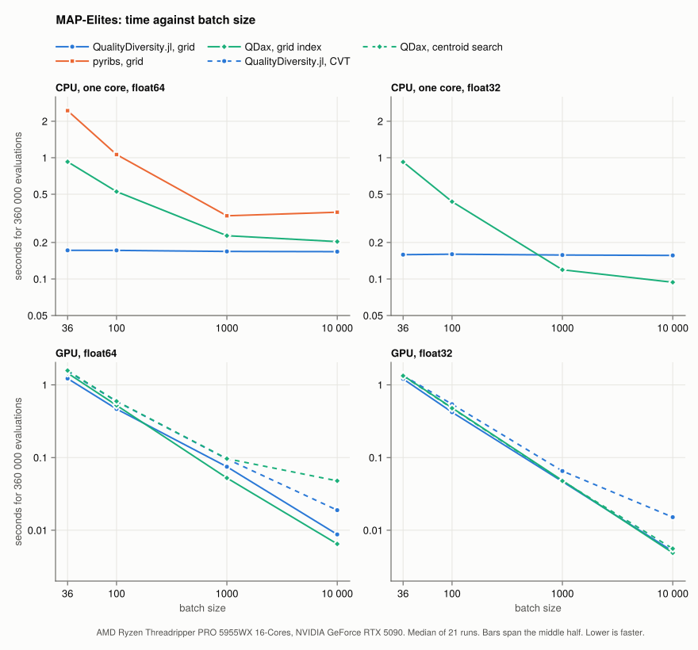
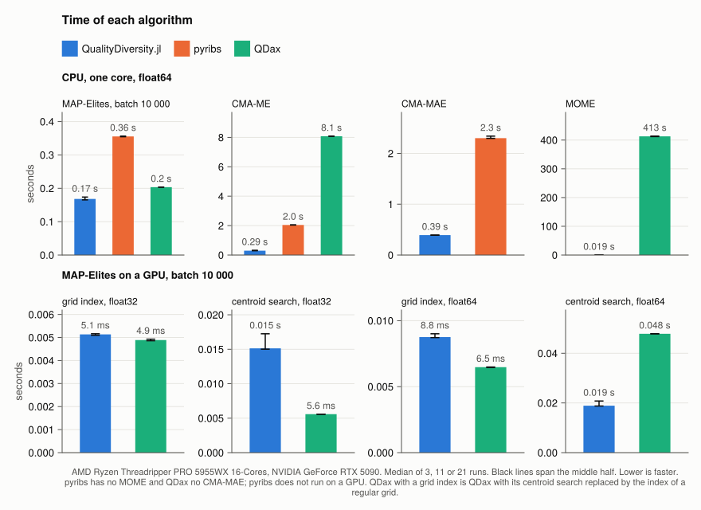

# QualityDiversity.jl, pyribs and QDax

The same algorithms with the same settings in three libraries: MAP-Elites, CMA-ME and
CMA-MAE on the 20-dimensional Rastrigin function, MOME on BiSphere, on one CPU core and on a
GPU. The sections below give the settings, how each library is used and what the numbers do
not say.





Every timed run is a row of a CSV file in [`results/`](results), with its coverage, maximum
fitness, QD score and the software versions; those files hold every number on this page.
`plot.jl` draws the two figures from them.

## MAP-Elites

| setting | value |
|---|---|
| problem | Rastrigin, 20 parameters, clipped to [-5.12, 5.12]; descriptor = mean of the first and of the last 10 clipped parameters |
| archive | 100 × 100 grid over [-5.12, 5.12]², plain MAP-Elites (no thresholds) |
| mutation | Gaussian, σ = 0.5, no clipping |
| initial population | one batch of uniform random solutions |
| budget | 360 000 evaluations, a multiple of every batch size |
| batch sizes | 36, 100, 1000, 10 000 |
| repeats | 21 timed runs per batch size, one seed each, after a warm-up run (3 for QDax with its own cell lookup, see below) |
| hardware | AMD Ryzen Threadripper PRO 5955WX (16 cores); every library pinned to one core with `taskset -c 2`, and QualityDiversity.jl also run with 8 threads on cores 0–7 |
| software | Julia 1.13.1, Python 3.12.3, pyribs 0.12.0, numpy 2.5.4, QDax 0.5.0, jax 0.11.2 (CPU) |

`compare.jl`, `compare.py` and `compare_qdax.py` define the problem
separately. Each prints the same columns. `compare.jl` and `compare.py` print
the fitness and descriptor of one fixed solution first, so the two can be
checked against each other:

```
Julia   reference fitness -407.77649216868974 descriptor (-3.0450526315789466, 3.0450526315789475)
pyribs  reference fitness -407.7764921686897  descriptor (-3.0450526315789475, 3.045052631578947)
```

Time covers building the archive, the initial batch and the rest of the
budget; compilation is excluded. Julia is timed with `@elapsed` and Python
with `time.perf_counter`, after one untimed run that compiles. "Middle half" is
the range from the first to the third quartile of the run times.

Every script prints a table and writes one row per timed run to a CSV file in
`results/` (`results.jl` and `results.py` write the same columns, with the
software versions, the commit and the hardware). `plot.jl` draws the figures of
the documentation from these files:

```
julia --project=docs benchmark/compare/plot.jl
```

`run_all.sh` runs every script on one machine with the core pinning described
below; the CSV files in `results/` come from one such run.

### How each library is used

- **QualityDiversity.jl:** `MAPElites` with a `GaussianMutation` and the
  default threaded `evaluate_batch`. The archive records
  its metrics after every step. It runs in `Float64` with the package's
  `Rastrigin`, and in `Float32` with the same function written as a
  `QDProblem` with `Float32` arithmetic, `genotype=Vector{Float32}`,
  `fitness=Float32` and `GaussianMutation(0.5f0)`. The archive then holds
  `Float32` genotypes and fitness values and the mutation produces `Float32`
  children, with no change to the package.
- **pyribs:** `GridArchive`, `GaussianEmitter` and `Scheduler`. The objective
  is vectorized numpy, the fastest way to write it in Python.
- **QDax:** the whole run, including the initial batch, is one `jax.jit`
  function that scans `MAPElites.scan_update`, as the QDax documentation
  recommends. The objective and the mutation are jitted array code, and QDax's
  own QD score, maximum fitness and coverage are computed after every step.
  QDax is written for accelerators and these runs use the CPU. It works in
  `float32` by default; `JAX_ENABLE_X64=1` gives `float64`, which is what the
  other two libraries use.

QDax finds the cell of a descriptor by comparing it with every centroid
(`get_cells_indices`). That works for any tessellation and is cheap on a GPU,
but on a CPU it costs batch size × number of cells and takes almost all of the
run time: at batch size 1000 a step takes 79 ms with it and 0.33 ms with the
grid index below. So QDax is reported twice:

- **QDax, centroid search** is QDax exactly as documented. It takes about 29 s
  whatever the batch size, so each batch size has only 3 timed runs; the run
  times differ by under 1%.
- **QDax, grid index** replaces that one function with the arithmetic index of a
  regular grid (`QDAX_GRID_LOOKUP=1`). A check at start-up confirms it assigns
  the same cell as QDax's own lookup to 20 000 random descriptors (0 differ).
  Nothing else changes. This is the fair CPU comparison: it is what someone
  who needs QDax to be fast on a CPU would write.

### Results

On one core, QualityDiversity.jl takes about the same time at every batch size (0.16 to
0.17 s for 360 000 evaluations, over two million evaluations per second), because each
solution costs the same work: one mutation, one evaluation and one insertion. The libraries
that vectorize a whole batch gain from larger batches. QualityDiversity.jl is faster than
QDax up to a batch size of 100 in both precisions (5.4 to 5.8 times at 36). In `float32`, the
precision QDax uses by default, QDax with the grid index is 1.3 and 1.7 times faster at batch
sizes 1000 and 10 000; in `float64` QualityDiversity.jl stays 1.2 to 1.35 times faster there.
`Float32` makes QualityDiversity.jl 7% to 8% faster, less than the factor of two QDax gains,
because Julia's scalar `cos` is not much faster in `Float32` while XLA vectorizes it. pyribs
is slower than both at every batch size, 14 times slower than QualityDiversity.jl at 36 and
about 2 times at 1000 and above. QDax with its own centroid search takes about 29 s whatever
the batch size, about 180 times longer, and is left out of the figure.

With 8 threads (`--threads=8`, cores 0–7) QualityDiversity.jl takes half the time from a
batch of 1000 up (0.076 to 0.080 s in `float64` and 0.070 to 0.072 s in `float32`). Only the evaluation
is threaded, and only when a batch would take longer than about 100 µs on one thread; a
Rastrigin evaluation takes about 200 ns, so batches of 36 and 100 stay on one thread. The
mutation and the insertion, which stay on one thread, take the rest. The archives are the same
as with one thread: the results do not depend on the number of threads.

Coverage and QD score agree across the libraries at each batch size to within the spread
between seeds. At batch size 10 000 every library fills fewer cells (about 0.94), because the
budget allows only 36 rounds.

### What the numbers do not say

- **One CPU core.** QDax is built for accelerators, where the work per step is
  parallel across thousands of solutions. These runs use one CPU core; the
  [GPU section](#map-elites-on-a-gpu) runs QDax and QualityDiversity.jl on a GPU.
- **Cheap objective.** Rastrigin takes about 200 ns per solution. A slower
  objective shrinks the ratios for every library, and an objective that cannot
  be written as jittable array code cannot be used in QDax at all.
- **The QDax grid index is my change.** It is a small, checked replacement of
  one function and not part of QDax. Both QDax variants are reported so the
  difference is visible.
- **`float32` against `float64`.** Compare like with like: QualityDiversity.jl
  in `float32` with QDax in `float32`, and `float64` with `float64`. pyribs
  runs in `float64`.
- **Spread.** The middle half of the run times lies within 8% of the median for
  every setting, and within 1% for the Python libraries, so differences of a few
  percent, such as between the 1- and 8-thread runs at a batch of 36, are level.
- **Threads.** Only QualityDiversity.jl is also run with several threads;
  multi-core JAX and numpy are not measured.

### Reproducing

`run_all.sh` runs all the commands of this page in order. The CPU runs alone:

```
# Julia
taskset -c 2 julia --threads=1 benchmark/compare/compare.jl
taskset -c 0-7 julia --threads=8 benchmark/compare/compare.jl

# pyribs and QDax
python -m venv venv && venv/bin/pip install -r benchmark/compare/requirements.txt
export OMP_NUM_THREADS=1 NUMBA_NUM_THREADS=1
export XLA_FLAGS="--xla_cpu_multi_thread_eigen=false intra_op_parallelism_threads=1"
taskset -c 2 venv/bin/python benchmark/compare/compare.py
QDAX_GRID_LOOKUP=1 taskset -c 2 venv/bin/python benchmark/compare/compare_qdax.py
JAX_ENABLE_X64=1 QDAX_GRID_LOOKUP=1 taskset -c 2 venv/bin/python benchmark/compare/compare_qdax.py
REPEATS=3 taskset -c 2 venv/bin/python benchmark/compare/compare_qdax.py   # about 10 minutes
```

## CMA-ME and CMA-MAE

`compare_cma.jl`, `compare_cma.py` and `compare_cma_qdax.py` run the emitters of
CMA-ME (Fontaine et al., 2020) and CMA-MAE (Fontaine and Nikolaidis, 2023) on the
same Rastrigin problem and the same 100 × 100 grid.

| setting | value |
|---|---|
| emitters | 5 independent CMA-ES searches, each with batch size 12 (`4 + floor(3 log 20)`), initial step size 1, first search from the origin, no bounds on the solutions |
| methods | CMA-ME with improvement emitters, with optimizing emitters, and with random direction emitters; CMA-MAE (learning rate 0.01, minimum threshold -820) |
| budget | 100 020 evaluations |
| repeats | 11 runs per method, one seed each, after a warm-up run; QDax compiles once per method |
| hardware, software | as above, one core; QDax at `float32` and `float64`, the others in `float64` |

Each library's own defaults are used for everything not listed. QualityDiversity.jl
steps the emitters one after the other, as the CMA-ME paper does, pyribs adds the
solutions of all emitters at once, and QDax runs one emitter of its pool per step.

### Results

Median over 11 runs on one core. QualityDiversity.jl is five to seven times faster than
pyribs and 22 to 28 times faster than QDax (0.29 s, 2.0 s and 8.1 s for CMA-ME with
improvement emitters; 0.39 s and 2.3 s for CMA-MAE, which QDax does not have). The QDax time
says little about QDax on an accelerator, which this does not measure: each QDax step here is
a batch of 12, far too small to use one. Coverage and QD score are those of the archive of the
best solutions (QD-score offset 820).

### Where the libraries agree and differ

- **CMA-ME with improvement, optimizing and random direction emitters:**
  QualityDiversity.jl and pyribs agree within the spread between seeds. The
  optimizing emitter fills few cells in both, as in the CMA-ME paper.
- **QDax's emitters behave differently.** Its optimizing emitters fill far more cells
  (coverage 0.62 against 0.08), and its random direction emitters fill fewer (0.82
  against 0.999). From reading the QDax code: it recombines all
  candidates of a batch with log-decreasing weights, not the best half or the
  accepted ones (a comment in the code says this departs from the paper), it
  restarts on its own rules, and an emitter measures improvement against the archive as
  it stood after that emitter's previous batch, not before the current one. It is a
  looser variant of CMA-ME, so its columns are not a check on the other two.
- **CMA-MAE: pyribs reaches a higher coverage than QualityDiversity.jl.** The cause
  is in pyribs's CMA-ES. Its rank-one covariance term is `c1² pc pcᵀ`, where
  Hansen's tutorial and the LM-MA-ES paper (Algorithm 1) have `c1 pc pcᵀ`, so the
  covariance matrix adapts almost only through the rank-mu term and the search stays
  rounder for longer, which helps CMA-MAE fill the grid. QualityDiversity.jl follows
  the textbook update. The CMA-MAE paper ran all its experiments with pyribs. With
  `strategy=QualityDiversity.PyribsCMAES`, which only changes that coefficient, QualityDiversity.jl
  reaches 0.560 coverage and a QD score of 2.99 million, as pyribs does (0.561 and 2.99
  million). Swapping the textbook term into pyribs lowers its CMA-MAE
  coverage to about 0.46, and the step size rule and the scaling of the path make
  no difference. CMA-ME with improvement emitters is the same with either update
  (QD scores 4.65 million with the textbook term and 4.66 million with the pyribs term).
- **Random direction ranking.** The CMA-ME paper ranks the accepted solutions by
  their projection on the direction, without putting new cells first. pyribs and
  `TwoStageRandomDirectionRanker` rank new cells first; `AcceptedRandomDirectionRanker`
  follows the paper. Here both give the same QD score (4.31 million).

### Not measured

The same caveats as for MAP-Elites hold: no GPU, one core and a cheap objective. The
run times are steady: the fastest run of every row is within 2% of the median. In
addition, 5 emitters of batch 12 and 100 000 evaluations are small next to the CMA-MAE
paper (15 emitters of batch 36 and 10 000 iterations), so the QD scores here do not
compare with its tables.

### Reproducing

```
# Julia
taskset -c 2 julia --threads=1 benchmark/compare/compare_cma.jl

# pyribs and QDax
export OMP_NUM_THREADS=1 NUMBA_NUM_THREADS=1
export XLA_FLAGS="--xla_cpu_multi_thread_eigen=false intra_op_parallelism_threads=1"
taskset -c 2 venv/bin/python benchmark/compare/compare_cma.py
taskset -c 2 venv/bin/python benchmark/compare/compare_cma_qdax.py
JAX_ENABLE_X64=1 taskset -c 2 venv/bin/python benchmark/compare/compare_cma_qdax.py   # about 6 minutes each
```

## MOME

`compare_mome.jl` and `compare_mome_qdax.py` run multi-objective MAP-Elites (Pierrot et al.,
2022) on the two-objective BiSphere benchmark of this package. pyribs has no multi-objective
archive, so only QualityDiversity.jl and QDax are compared.

| setting | value |
|---|---|
| problem | BiSphere, 10 parameters, clipped to [-5.12, 5.12]; objectives `-‖x - 1‖²` and `-‖x + 1‖²`, both maximized; descriptor = mean of the first and of the last 5 clipped parameters |
| archive | 20 × 20 grid over [-5.12, 5.12]², a Pareto front of at most 50 solutions in each cell |
| hypervolume | reference point `(-374.5, -374.5)`, the lowest value of both objectives |
| mutation | Gaussian, σ = 0.2, one emitter, batch size 64; parents drawn from a uniformly chosen occupied cell and then uniformly from its front |
| initial population | one batch of uniform random solutions |
| budget | 100 032 evaluations |
| repeats | 11 runs for QualityDiversity.jl, 3 for QDax (about 7 minutes each), one seed each, after a warm-up run |
| hardware, software | as above, one core; both in `float64` (QDax with `JAX_ENABLE_X64=1`), QDax with its own centroid search |

Both print the same columns, and the first lines of the two outputs give the fitness and the
descriptor of one fixed solution, as a check that the problems agree.

### Results

Median over the runs. The MOQD score is the sum over the cells of the hypervolume of their
fronts, and the global hypervolume is that of the Pareto front of all solutions together.
QualityDiversity.jl takes 0.019 s and QDax 413 s. Coverage is 0.328 and 0.323, the MOQD score
15.29 and 15.21 million, and the global hypervolume 139 936 and 139 921.

The results agree. The global hypervolume and the hypervolume of the best cell are equal to within
0.01% and 0.04%. Coverage and MOQD score are noisy from run to run: over 30 seeds the coverage of
QualityDiversity.jl lies between 0.25 and 0.43 and the MOQD score between 11.9 and 19.0 million,
and the QDax values are inside those ranges.

QualityDiversity.jl is about 20 000 times faster here. That ratio says little about QDax
in the setting it is made for. QDax inserts the solutions of a batch one at a time in a scan
over arrays of fixed shape, which is slow on one CPU core and says nothing about its speed on
an accelerator, and the problem is cheap. It does show what a single core does with the two
approaches when the objectives are analytic.

### How the fronts were checked

The per-cell update of QualityDiversity.jl was run on the same insertion sequences as QDax's
`MOMERepertoire` in one cell, with two and three objectives and fronts of 4, 10 and 50 solutions
(`test/reference`). Both keep the same solutions in every case, including which solutions a full
front keeps. The hypervolume agrees with the indicator of pymoo to 1e-15 for two, three and
four objectives. One difference is by design: QualityDiversity.jl rejects a solution whose
objectives equal those of a stored one, where QDax keeps both.

### Reproducing

```
# Julia
taskset -c 2 julia --threads=1 benchmark/compare/compare_mome.jl

# QDax
export XLA_FLAGS="--xla_cpu_multi_thread_eigen=false intra_op_parallelism_threads=1"
JAX_ENABLE_X64=1 REPEATS=3 taskset -c 2 venv/bin/python benchmark/compare/compare_mome_qdax.py   # about 30 minutes
```

## MAP-Elites on a GPU

The MAP-Elites comparison of the first section, with the archive, the variation and the
evaluation on a GPU. `gpu/compare_gpu.jl` runs `MAPElites(prob; device=CuArray)`, which
stores a `DeviceGridArchive` in CUDA arrays and draws children with a
`DeviceVariationEmitter`; the Rastrigin function is a `QDProblem` that a kernel evaluates
one solution per thread. QDax runs `compare_qdax.py` unchanged, with the CUDA build of jax.
pyribs 0.12 keeps its grid archive and Gaussian emitter in numpy, so it cannot run this
on a GPU. The CPU runs of the first section were made on the same machine.

| setting | value |
|---|---|
| problem, archive, mutation, budget, batch sizes | as in the first section |
| repeats | 21 timed runs per batch size, one seed each, after a warm-up run |
| hardware | NVIDIA GeForce RTX 5090 (driver 580.178.04), AMD Ryzen Threadripper PRO 5955WX; the host side of every run pinned to one core with `taskset -c 2` |
| software | Julia 1.13.1, CUDA.jl 6.4.2, KernelAbstractions 0.9.45; Python 3.12.3, jax 0.11.2 with `jax-cuda12-plugin`, QDax 0.5.0 |

### Results

On the GPU the two libraries are level in `float32` at every batch size (5.1 ms and 4.9 ms
at 10 000). Each step costs both about 0.1 ms whatever the batch size, so up to a batch of 100
the GPU is slower than one CPU core, and at 1000 and above it is faster: at 10 000 the whole
budget of 360 000 evaluations takes 5 ms, 31 times less than one core and 14 times less than
eight. In `float64` QDax with its own cell lookup slows down at large batches, because it
compares every descriptor with every centroid and this card computes `float64` slowly; QDax
with the grid index is faster than QualityDiversity.jl at 1000 and 10 000 in `float64` (6.5 ms
against 8.8 ms at 10 000). Coverage and QD score agree with the CPU runs within the spread
between seeds.

### CVT archive

`compare_gpu.jl` also runs a `DeviceCVTArchive` whose centroids are the centers of the
100 × 100 grid cells, the centroids that `compare_qdax.py` gives QDax. This compares the
nearest-centroid search of the two libraries directly: QDax compares every descriptor with
every centroid, and QualityDiversity.jl with the centroids of its bucket in a grid of buckets
built once on the host (about 9 here). Both find the same cells as the grid, and the
`float32` runs of the two QualityDiversity.jl archives give identical QD scores.

In `float32` QDax is faster from a batch of 100, 2.7 times at 10 000 (15 ms against 5.6 ms). The device archives
keep descriptors in `Float64` and find the nearest centroid in `Float64`, so that host and
device assign the same cells, and this card computes `Float64` slowly; the CVT archive also
pays for a second kernel per step. In `float64` the two are level up to a batch of 1000,
and the bucket search is 2.5 times faster than QDax's at 10 000, because it computes about
9 distances per descriptor instead of 10 000.

### CMA-ME

`compare_cma_gpu.jl` runs CMA-ME on the same problem and grid, with 1 200 000
evaluations, on the host and with a `DeviceCMAEmitter`, for 5, 50 and 500 CMA-ES searches
of 12 candidates each (8 host threads on cores 0–7, 5 runs per row). The device emitter
samples and updates the searches on the host threads and evaluates and adds all their
candidates on the GPU as one batch, so each search sees the archive as it was before the
round; the host `CMAME` steps its searches one after another.

With the 5 searches of the CMA-ME paper a round is a batch of 60, too small for a GPU, and
the device emitter is 3.8 times slower (4.9 s against 1.3 s). With 500 searches it is 6.8 times faster than the
host with as many searches (0.33 s against 2.2 s), and 3.9 times faster than the host with 5. The QD scores agree
within the spread between seeds. QDax runs one emitter of its pool per step, so it has no
counterpart; pyribs adds the batches of all its emitters at once, on the CPU.

### Not measured

- **Other GPUs.** The kernels are written with KernelAbstractions and should run on AMD and
  Intel GPUs as well, but only CUDA has been timed, and the tests run them on the CPU. Apple
  GPUs have no `Float64`, which the cell lookup needs.
- **CMA-MAE and MOME.** They stay on the host. For reference, QDax on this GPU takes 0.95 s
  for the CMA-ME of the CPU comparison (5 emitters of 12), where QualityDiversity.jl on one
  core takes 0.29 s, and 3.5 s for MOME, where QualityDiversity.jl takes 0.019 s (QDax
  inserts a batch one solution at a time). These two QDax runs are not part of `run_all.sh`.

### Reproducing

```
# On a machine with several GPUs, choose one by its nvidia-smi index; without
# CUDA_DEVICE_ORDER the CUDA runtime numbers the devices fastest first.
export CUDA_DEVICE_ORDER=PCI_BUS_ID CUDA_VISIBLE_DEVICES=1

# Julia
taskset -c 2 julia benchmark/compare/gpu/compare_gpu.jl
taskset -c 0-7 julia --threads=8 benchmark/compare/gpu/compare_cma_gpu.jl

# QDax, with the CUDA build of jax
python -m venv venv && venv/bin/pip install -r benchmark/compare/requirements.txt "jax[cuda12]"
export XLA_PYTHON_CLIENT_PREALLOCATE=false
taskset -c 2 venv/bin/python benchmark/compare/compare_qdax.py
JAX_ENABLE_X64=1 taskset -c 2 venv/bin/python benchmark/compare/compare_qdax.py
QDAX_GRID_LOOKUP=1 taskset -c 2 venv/bin/python benchmark/compare/compare_qdax.py
JAX_ENABLE_X64=1 QDAX_GRID_LOOKUP=1 taskset -c 2 venv/bin/python benchmark/compare/compare_qdax.py
```
